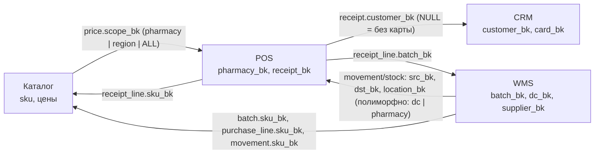

# ER-диаграммы

Диаграммы четырёх сервисов (mermaid) **сгенерированы из системных каталогов работающих баз**: `python scripts/gen_erd.py` (стенд должен быть поднят), поэтому они всегда соответствуют фактической схеме.
На каждой диаграмме видны ключи (`PK`, `FK`, `UK`), типы и обязательность (`NOT NULL` / `NULL`); связи между таблицами — только внутри сервиса. Под диаграммой — интерфейс `contract` и таблица **логических ссылок по business key** на другие сервисы
(кросс-сервисных FOREIGN KEY нет и быть не может: это разные базы).

| сервис | диаграмма |
|--------|-----------|
| CRM | [crm_service.md](crm_service.md) |
| Каталог | [catalog_service.md](catalog_service.md) |
| POS | [pos_service.md](pos_service.md) |
| WMS | [wms_service.md](wms_service.md) |

## Связи между сервисами (по business key)

Стрелка значит «хранит значение business key сущности, которой владеет другой сервис». Ссылки не проверяются СУБД (разные базы) — целостность держит приложение/генератор и проверяют кросс-проверки чекера X01–X10;
для двух самых важных ограничений (I8, I10) нужные поля чужих справочников хранятся в POS локально (`pos.sku_ref`, `pos.batch_ref`, ADR-0004).
