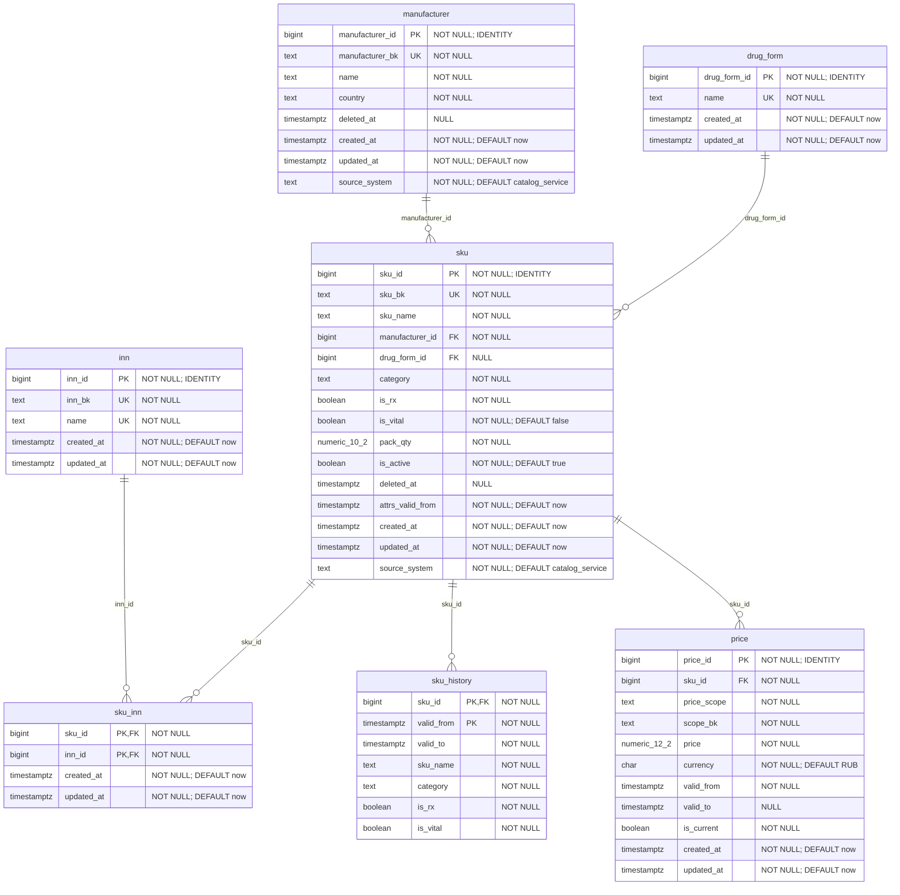

# ER-диаграмма: catalog_service_db

Номенклатура, МНН, производители, цены с историей. Схема `catalog` (базовые таблицы) и интерфейс `contract` (представления для DWH).

Диаграмма **сгенерирована** из системных каталогов работающей базы (`python scripts/gen_erd.py`), поэтому отражает фактическую схему.
Обозначения: `PK` — первичный ключ, `FK` — внешний ключ (только внутри сервиса), `UK` — уникальный ключ (в т.ч. business key). В комментарии: `NOT NULL` / `NULL` — обязательность, `GENERATED` — вычисляемая колонка, `IDENTITY` — суррогатный ключ.

## Интерфейс `contract` (представления)

| представление | колонки (имя тип) |
|---|---|
| `contract.v_price` | sku text, price_scope text, scope_bk text, price numeric(12,2), currency text, valid_from timestamptz, valid_to timestamptz, is_current boolean, updated_at timestamptz |
| `contract.v_sku` | sku text, sku_name text, inn_name text, manufacturer_name text, drug_form text, category text, is_rx boolean, is_vital boolean, pack_qty numeric(10,2), is_active boolean, updated_at timestamptz |

## Логические ссылки на другие сервисы (по business key, **без FOREIGN KEY**)

| колонка этого сервиса | ссылается на | комментарий |
|---|---|---|
| `price.scope_bk` | `pos_service_db`: `pharmacy.pharmacy_bk` | если price_scope = 'pharmacy'; для 'region' — название региона из pos.pharmacy.region; для 'chain' — 'ALL' |

## Защиты схемы (CHECK / EXCLUDE и триггеры)

CHECK/EXCLUDE: **15**, триггеров: **16** (полный список — в `migrations/catalog/`).

- `inn.inn_inn_bk_check`: `CHECK ((inn_bk ~ '^INN-[0-9]{4}$'::text))`
- `manufacturer.manufacturer_manufacturer_bk_check`: `CHECK ((manufacturer_bk ~ '^MFR-[0-9]{4}$'::text))`
- `price.price_check`: `CHECK (((valid_to IS NULL) OR (valid_to > valid_from)))`
- `price.price_check1`: `CHECK ((is_current OR (valid_to IS NOT NULL)))`
- `price.price_check2`: `CHECK (((price_scope = 'chain'::text) = (scope_bk = 'ALL'::text)))`
- `price.price_currency_check`: `CHECK (((currency)::text = upper((currency)::text)))`
- `price.price_no_overlap`: `EXCLUDE USING gist (sku_id WITH =, price_scope WITH =, scope_bk WITH =, tstzrange(valid_from, valid_to, '[)'::text) WITH &&)`
- `price.price_price_check`: `CHECK ((price > (0)::numeric))`
- `price.price_price_scope_check`: `CHECK ((price_scope = ANY (ARRAY['chain'::text, 'region'::text, 'pharmacy'::text])))`
- `sku.sku_category_check`: `CHECK ((category = ANY (ARRAY['rx'::text, 'otc'::text, 'supplement'::text, 'device'::text, 'cosmetics'::text])))`
- `sku.sku_check`: `CHECK ((is_rx = (category = 'rx'::text)))`
- `sku.sku_check1`: `CHECK (((deleted_at IS NULL) OR (NOT is_active)))`
- `sku.sku_pack_qty_check`: `CHECK ((pack_qty > (0)::numeric))`
- `sku.sku_sku_bk_check`: `CHECK ((sku_bk ~ '^SKU-[0-9]{6}$'::text))`
- `sku_history.sku_history_check`: `CHECK ((valid_to > valid_from))`
