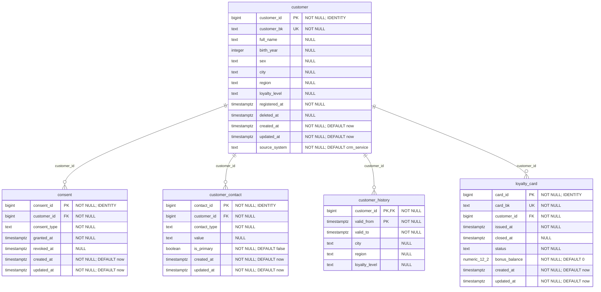

# ER-диаграмма: crm_service_db

Клиенты, контакты, согласия, карты лояльности. Схема `crm` (базовые таблицы) и интерфейс `contract` (представления для DWH).

Диаграмма **сгенерирована** из системных каталогов работающей базы (`python scripts/gen_erd.py`), поэтому отражает фактическую схему.
Обозначения: `PK` — первичный ключ, `FK` — внешний ключ (только внутри сервиса), `UK` — уникальный ключ (в т.ч. business key). В комментарии: `NOT NULL` / `NULL` — обязательность, `GENERATED` — вычисляемая колонка, `IDENTITY` — суррогатный ключ.

## Интерфейс `contract` (представления)

| представление | колонки (имя тип) |
|---|---|
| `contract.v_customer` | customer_bk text, birth_year integer, sex text, city text, region text, loyalty_level text, marketing_opt_in boolean, registered_at timestamptz, updated_at timestamptz |
| `contract.v_loyalty_card` | card_bk text, customer_bk text, issued_at timestamptz, closed_at timestamptz, status text, bonus_balance numeric(12,2), updated_at timestamptz |

## Защиты схемы (CHECK / EXCLUDE и триггеры)

CHECK/EXCLUDE: **13**, триггеров: **10** (полный список — в `migrations/crm/`).

- `consent.consent_check`: `CHECK (((revoked_at IS NULL) OR (revoked_at >= granted_at)))`
- `consent.consent_consent_type_check`: `CHECK ((consent_type = ANY (ARRAY['personal_data'::text, 'marketing'::text])))`
- `customer.customer_birth_year_check`: `CHECK (((birth_year >= 1900) AND (birth_year <= 2100)))`
- `customer.customer_customer_bk_check`: `CHECK ((customer_bk ~ '^CUST-[0-9]{6}$'::text))`
- `customer.customer_loyalty_level_check`: `CHECK ((loyalty_level = ANY (ARRAY['basic'::text, 'silver'::text, 'gold'::text, 'platinum'::text])))`
- `customer.customer_sex_check`: `CHECK ((sex = ANY (ARRAY['M'::text, 'F'::text])))`
- `customer_contact.customer_contact_contact_type_check`: `CHECK ((contact_type = ANY (ARRAY['phone'::text, 'email'::text])))`
- `customer_history.customer_history_check`: `CHECK ((valid_to > valid_from))`
- `loyalty_card.loyalty_card_bonus_balance_check`: `CHECK ((bonus_balance >= (0)::numeric))`
- `loyalty_card.loyalty_card_card_bk_check`: `CHECK ((card_bk ~ '^CARD-[0-9]{8}$'::text))`
- `loyalty_card.loyalty_card_check`: `CHECK (((status = 'closed'::text) = (closed_at IS NOT NULL)))`
- `loyalty_card.loyalty_card_check1`: `CHECK (((closed_at IS NULL) OR (closed_at >= issued_at)))`
- `loyalty_card.loyalty_card_status_check`: `CHECK ((status = ANY (ARRAY['active'::text, 'blocked'::text, 'closed'::text])))`
