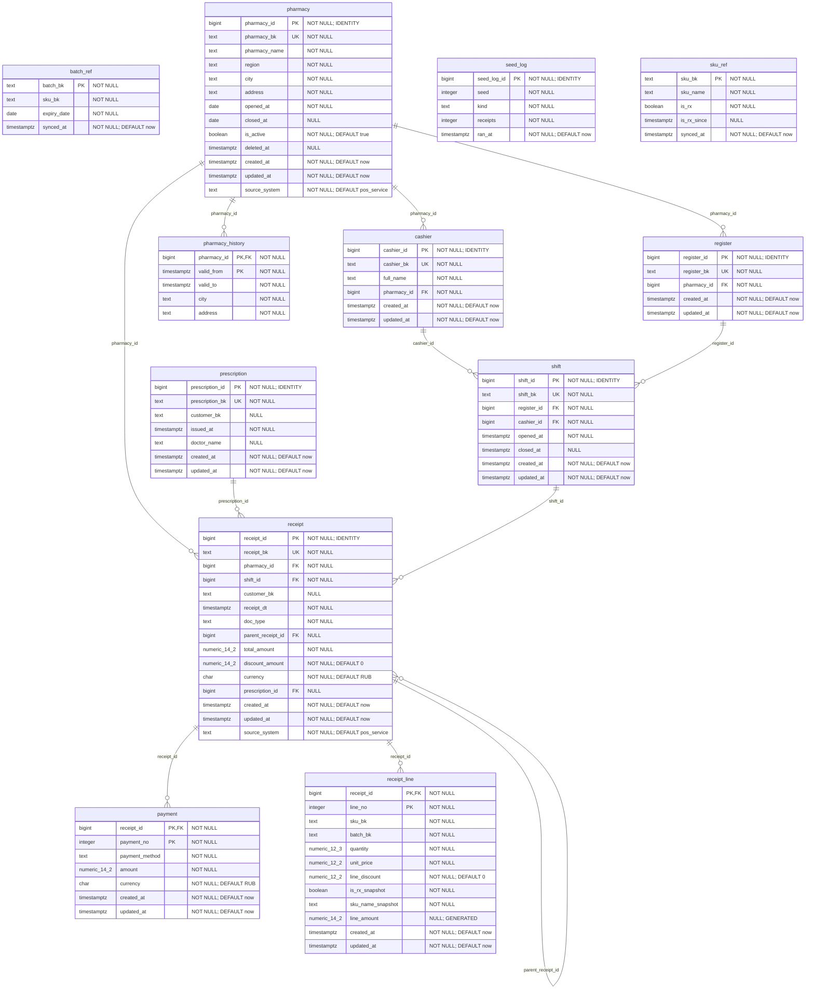

# ER-диаграмма: pos_service_db

Аптеки, кассы, смены, кассовые документы, оплаты. Схема `pos` (базовые таблицы) и интерфейс `contract` (представления для DWH).

Диаграмма **сгенерирована** из системных каталогов работающей базы (`python scripts/gen_erd.py`), поэтому отражает фактическую схему.
Обозначения: `PK` — первичный ключ, `FK` — внешний ключ (только внутри сервиса), `UK` — уникальный ключ (в т.ч. business key). В комментарии: `NOT NULL` / `NULL` — обязательность, `GENERATED` — вычисляемая колонка, `IDENTITY` — суррогатный ключ.

## Интерфейс `contract` (представления)

| представление | колонки (имя тип) |
|---|---|
| `contract.v_payment` | receipt_bk text, payment_no integer, payment_method text, amount numeric(14,2), currency text, updated_at timestamptz |
| `contract.v_pharmacy` | pharmacy_bk text, pharmacy_name text, region text, city text, address text, opened_at date, closed_at date, is_active boolean, updated_at timestamptz |
| `contract.v_receipt` | receipt_bk text, pharmacy_bk text, customer_bk text, cashier_bk text, shift_bk text, receipt_dt timestamptz, doc_type text, parent_receipt_bk text, total_amount numeric(14,2), discount_amount numeric(14,2), currency text, prescription_bk text, updated_at timestamptz |
| `contract.v_receipt_line` | receipt_bk text, line_no integer, sku text, batch_bk text, quantity numeric(12,3), unit_price numeric(12,2), line_discount numeric(12,2), line_amount numeric(14,2), is_rx_snapshot boolean, sku_name_snapshot text, updated_at timestamptz |

## Логические ссылки на другие сервисы (по business key, **без FOREIGN KEY**)

| колонка этого сервиса | ссылается на | комментарий |
|---|---|---|
| `receipt.customer_bk` | `crm_service_db`: `customer.customer_bk` | покупатель; NULL = покупка без карты |
| `prescription.customer_bk` | `crm_service_db`: `customer.customer_bk` | пациент по рецепту |
| `receipt_line.sku_bk` | `catalog_service_db`: `sku.sku_bk` | позиция каталога (+ локальная копия sku_ref) |
| `receipt_line.batch_bk` | `wms_service_db`: `batch.batch_bk` | серия, из которой продано (+ локальная копия batch_ref) |
| `sku_ref.sku_bk` | `catalog_service_db`: `sku.sku_bk` | копия справочника для проверки I8/I10 |
| `batch_ref.batch_bk` | `wms_service_db`: `batch.batch_bk` | копия справочника для проверки I8 |
| `batch_ref.sku_bk` | `catalog_service_db`: `sku.sku_bk` |  |

## Защиты схемы (CHECK / EXCLUDE и триггеры)

CHECK/EXCLUDE: **27**, триггеров: **24** (полный список — в `migrations/pos/`).

- `batch_ref.batch_ref_batch_bk_check`: `CHECK ((batch_bk ~ '^BATCH-[0-9]{4}-[0-9]{5}$'::text))`
- `cashier.cashier_cashier_bk_check`: `CHECK ((cashier_bk ~ '^CSH-[0-9]{6}$'::text))`
- `payment.payment_amount_check`: `CHECK ((amount > (0)::numeric))`
- `payment.payment_currency_check`: `CHECK (((currency)::text = upper((currency)::text)))`
- `payment.payment_payment_method_check`: `CHECK ((payment_method = ANY (ARRAY['cash'::text, 'card'::text, 'bonus'::text, 'certificate'::text])))`
- `payment.payment_payment_no_check`: `CHECK ((payment_no > 0))`
- `pharmacy.pharmacy_check`: `CHECK (((closed_at IS NULL) OR (closed_at >= opened_at)))`
- `pharmacy.pharmacy_check1`: `CHECK ((is_active = (closed_at IS NULL)))`
- `pharmacy.pharmacy_pharmacy_bk_check`: `CHECK ((pharmacy_bk ~ '^PH-[0-9]{4}$'::text))`
- `pharmacy_history.pharmacy_history_check`: `CHECK ((valid_to > valid_from))`
- `prescription.prescription_prescription_bk_check`: `CHECK ((prescription_bk ~ '^RX-[0-9]{4}-[0-9]{7}$'::text))`
- `receipt.receipt_check`: `CHECK (((doc_type = 'refund'::text) = (parent_receipt_id IS NOT NULL)))`
- `receipt.receipt_currency_check`: `CHECK (((currency)::text = upper((currency)::text)))`
- `receipt.receipt_discount_amount_check`: `CHECK ((discount_amount >= (0)::numeric))`
- `receipt.receipt_doc_type_check`: `CHECK ((doc_type = ANY (ARRAY['sale'::text, 'refund'::text])))`
- `receipt.receipt_receipt_bk_check`: `CHECK ((receipt_bk ~ '^RCPT-[0-9]{8}-[0-9]{6}$'::text))`
- `receipt.receipt_total_amount_check`: `CHECK ((total_amount >= (0)::numeric))`
- `receipt_line.line_discount_not_above_gross`: `CHECK ((line_discount <= (quantity * unit_price)))`
- `receipt_line.receipt_line_line_discount_check`: `CHECK ((line_discount >= (0)::numeric))`
- `receipt_line.receipt_line_line_no_check`: `CHECK ((line_no > 0))`
- `receipt_line.receipt_line_quantity_check`: `CHECK ((quantity > (0)::numeric))`
- `receipt_line.receipt_line_unit_price_check`: `CHECK ((unit_price >= (0)::numeric))`
- `register.register_register_bk_check`: `CHECK ((register_bk ~ '^REG-[0-9]{4}-[0-9]{2}$'::text))`
- `shift.shift_check`: `CHECK (((closed_at IS NULL) OR (closed_at > opened_at)))`
- `shift.shift_shift_bk_check`: `CHECK ((shift_bk ~ '^SHF-[0-9]{8}-[0-9]{4}-[0-9]{2}$'::text))`
- `sku_ref.sku_ref_check`: `CHECK (((NOT is_rx) OR (is_rx_since IS NOT NULL)))`
- `sku_ref.sku_ref_sku_bk_check`: `CHECK ((sku_bk ~ '^SKU-[0-9]{6}$'::text))`
