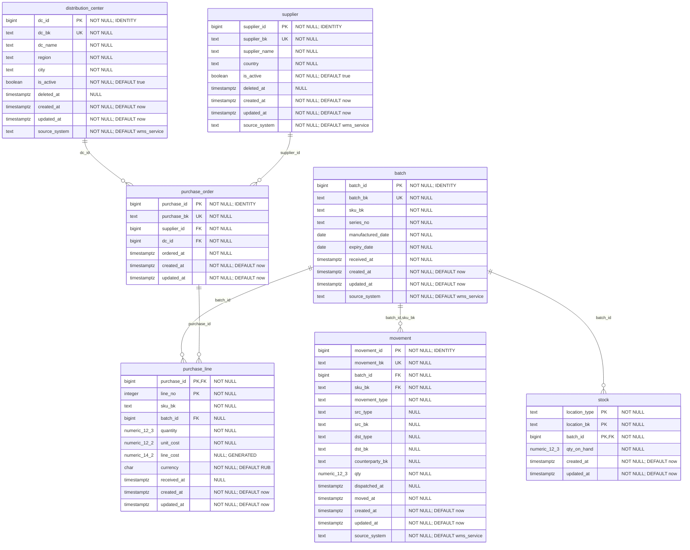

# ER-диаграмма: wms_service_db

Поставщики, распредцентры, закупки, партии, движения, остатки. Схема `wms` (базовые таблицы) и интерфейс `contract` (представления для DWH).

Диаграмма **сгенерирована** из системных каталогов работающей базы (`python scripts/gen_erd.py`), поэтому отражает фактическую схему.
Обозначения: `PK` — первичный ключ, `FK` — внешний ключ (только внутри сервиса), `UK` — уникальный ключ (в т.ч. business key). В комментарии: `NOT NULL` / `NULL` — обязательность, `GENERATED` — вычисляемая колонка, `IDENTITY` — суррогатный ключ.

## Интерфейс `contract` (представления)

| представление | колонки (имя тип) |
|---|---|
| `contract.v_batch` | batch_bk text, sku text, series_no text, manufactured_date date, expiry_date date, received_at timestamptz, updated_at timestamptz |
| `contract.v_distribution_center` | dc_bk text, dc_name text, region text, city text, is_active boolean, updated_at timestamptz |
| `contract.v_movement` | movement_bk text, batch_bk text, sku text, movement_type text, src_type text, src_bk text, dst_type text, dst_bk text, qty numeric(12,3), dispatched_at timestamptz, moved_at timestamptz, updated_at timestamptz |
| `contract.v_purchase_line` | purchase_bk text, line_no integer, supplier_bk text, dc_bk text, sku text, batch_bk text, ordered_at timestamptz, received_at timestamptz, quantity numeric(12,3), unit_cost numeric(12,2), line_cost numeric(14,2), currency text, updated_at timestamptz |
| `contract.v_stock` | location_type text, location_bk text, sku text, batch_bk text, qty_on_hand numeric(12,3), updated_at timestamptz |
| `contract.v_supplier` | supplier_bk text, supplier_name text, country text, is_active boolean, updated_at timestamptz |

## Логические ссылки на другие сервисы (по business key, **без FOREIGN KEY**)

| колонка этого сервиса | ссылается на | комментарий |
|---|---|---|
| `batch.sku_bk` | `catalog_service_db`: `sku.sku_bk` | товарная позиция партии |
| `purchase_line.sku_bk` | `catalog_service_db`: `sku.sku_bk` | закупаемая позиция |
| `movement.sku_bk` | `catalog_service_db`: `sku.sku_bk` | (вместе с batch_id — составной FK внутри сервиса) |
| `movement.src_bk / dst_bk` | `pos_service_db`: `pharmacy.pharmacy_bk` | если src_type/dst_type = 'pharmacy' (полиморфная ссылка) |
| `stock.location_bk` | `pos_service_db`: `pharmacy.pharmacy_bk` | если location_type = 'pharmacy' (полиморфная ссылка) |

## Защиты схемы (CHECK / EXCLUDE и триггеры)

CHECK/EXCLUDE: **26**, триггеров: **15** (полный список — в `migrations/wms/`).

- `batch.batch_batch_bk_check`: `CHECK ((batch_bk ~ '^BATCH-[0-9]{4}-[0-9]{5}$'::text))`
- `batch.batch_check`: `CHECK ((expiry_date > manufactured_date))`
- `batch.batch_not_expired_at_receipt`: `CHECK ((expiry_date >= ((received_at AT TIME ZONE 'UTC'::text))::date))`
- `batch.batch_sku_bk_check`: `CHECK ((sku_bk ~ '^SKU-[0-9]{6}$'::text))`
- `distribution_center.distribution_center_dc_bk_check`: `CHECK ((dc_bk ~ '^DC-[0-9]{2}$'::text))`
- `movement.movement_check`: `CHECK (((src_type IS NULL) = (src_bk IS NULL)))`
- `movement.movement_check1`: `CHECK (((dst_type IS NOT NULL) OR (dst_bk IS NULL)))`
- `movement.movement_check2`: `CHECK (((dst_type = ANY (ARRAY['dc'::text, 'pharmacy'::text])) = (dst_bk IS NOT NULL)))`
- `movement.movement_check3`: `CHECK (((dispatched_at IS NULL) OR (dispatched_at <= moved_at)))`
- `movement.movement_check4`: `CHECK (((src_type IS DISTINCT FROM dst_type) OR (src_bk IS DISTINCT FROM dst_bk)))`
- `movement.movement_dst_type_check`: `CHECK ((dst_type = ANY (ARRAY['dc'::text, 'pharmacy'::text, 'customer'::text])))`
- `movement.movement_movement_bk_check`: `CHECK ((movement_bk ~ '^MOV-[0-9]{9}$'::text))`
- `movement.movement_movement_type_check`: `CHECK ((movement_type = ANY (ARRAY['receipt'::text, 'transfer'::text, 'sale_writeoff'::text, 'return'::text, 'writeoff'::text])))`
- `movement.movement_qty_check`: `CHECK ((qty > (0)::numeric))`
- `movement.movement_src_type_check`: `CHECK ((src_type = ANY (ARRAY['dc'::text, 'pharmacy'::text, 'supplier'::text])))`
- `purchase_line.purchase_line_check`: `CHECK (((received_at IS NOT NULL) = (batch_id IS NOT NULL)))`
- `purchase_line.purchase_line_currency_check`: `CHECK (((currency)::text = upper((currency)::text)))`
- `purchase_line.purchase_line_line_no_check`: `CHECK ((line_no > 0))`
- `purchase_line.purchase_line_quantity_check`: `CHECK ((quantity > (0)::numeric))`
- `purchase_line.purchase_line_sku_bk_check`: `CHECK ((sku_bk ~ '^SKU-[0-9]{6}$'::text))`
- `purchase_line.purchase_line_unit_cost_check`: `CHECK ((unit_cost >= (0)::numeric))`
- `purchase_order.purchase_order_purchase_bk_check`: `CHECK ((purchase_bk ~ '^PO-[0-9]{4}-[0-9]{6}$'::text))`
- `stock.stock_location_type_check`: `CHECK ((location_type = ANY (ARRAY['dc'::text, 'pharmacy'::text])))`
- `stock.stock_not_negative`: `CHECK ((qty_on_hand >= (0)::numeric))`
- `supplier.supplier_supplier_bk_check`: `CHECK ((supplier_bk ~ '^SUP-[0-9]{4}$'::text))`
